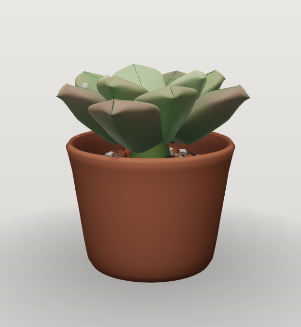

# a little succulent

**English** · [简体中文](./README.zh-CN.md)

[](https://github.com/taozhihaoo/a-little-succulent/actions/workflows/ci.yml)

A tiny 3D succulent that lives on your desktop.

It is not an animation on a loop. It is a small simulated plant: leaves are born, expand, blush in the sun, thin out when thirsty and eventually drop; the stem slowly thickens and lignifies into an old trunk; offsets sprout at the base, and once in a while it pushes out a flower spike. Close the app for three days, open it again, and it will be exactly three days older — same leaves, same scars, same history.

<p align="center">
  
</p>

Windows desktop widget · Electron + three.js · transparent, frameless, always on top, click-through outside the plant.

---

## Features

- **Real growth, not a loop** — a fixed-step simulation drives leaf birth → expansion → maturity → senescence → drop, plus stretching (etiolation) under low light, drought stress, and leaf propagation.
- **Deterministic** — `seed + input sequence + simulationVersion` reproduces the same plant byte for byte. Fast-forwarding cannot desync the plant.
- **Genetics** — every plant has a genome (leaf shape, density, colour palette, farina, gloss…). 100 seeds produce 100 visibly different rosettes. Rare mutations add variegation and cristation.
- **Care loop** — right-click to water. Water changes turgor, soil colour, gloss and growth rate; a neglected plant stalls and shows stress colours at the leaf tips.
- **Long-term events** — flowering spike with buds that open and wither, offsets, leaf cuttings rooting into new plants, an old trunk that lengthens and turns woody, and a journal timeline of everything that happened.
- **Desktop-native** — transparent frameless window, always on top, drag from the plant, mouse click-through on empty pixels, tray menu, autostart, size/opacity settings, silent auto-update.
- **Seed codes** — export a plant as a short Base32 string (with checksum) and hand it to someone else; they can grow the exact same plant.
- **Photos** — `Shift+P` saves a transparent PNG of the moment, named with the plant's age in days.

## Controls

| Action | How |
| --- | --- |
| Water | Right-click the plant → **浇水** (Water) |
| Move the widget | Drag the plant / pot |
| Journal (timeline + achievements) | `J` |
| Settings (size, opacity, autostart, click-through, reset save) | `S` or tray → 设置 |
| Photo (transparent PNG → Downloads) | `Shift+P` |
| Hide / quit | Tray menu |

> The UI is currently Simplified Chinese only; an English locale is on the roadmap.

## Getting started

Requirements: **Node.js ≥ 22**, **pnpm 12** (CI pins `pnpm/action-setup` to 12.8.1).

```bash
pnpm install
pnpm dev          # Vite dev server + Electron, hot reload for the renderer
pnpm build        # renderer (vite) + main/preload (esbuild) → apps/desktop/out
pnpm typecheck    # tsc for sim / render / desktop(web+node)
pnpm lint
pnpm test         # vitest: simulation determinism, geometry, persistence, scheduler
```

Packaging (Windows, NSIS installer via electron-builder):

```bash
pnpm --filter @succulent/desktop dist        # installer → apps/desktop/dist-pkg
pnpm --filter @succulent/desktop dist:dir    # unpacked app dir (A/B build output)
```

## How it works

```text
packages/sim     pure TypeScript simulation. No three.js, no DOM, no Node, no clock.
                 World state → PhenotypeSnapshot (poses, colours, water, dayPhase)
packages/render  three.js. Reads snapshots only; never back-computes plant state.
                 Owns the render scheduler (DeepIdle / Ambient / Active) and all geometry.
apps/desktop     Electron shell: window, tray, fullscreen detect, persistence, updates,
                 Steam achievements. Renderer = composition root + UI.
```

The contract between the layers is one immutable snapshot object:

- **Determinism** — the simulation advances in fixed steps on a 5-minute grid; all randomness comes from a seeded PRNG keyed by `seed|simTime`, so replaying the event log lands on the same state.
- **Wall-clock catch-up** — on launch the engine advances to `Date.now()`, so time passes while the app is closed. A monotonic clock guards against system clock rollback.
- **Save = state, not geometry** — `save.json` + append-only `events.jsonl` + `inputs.jsonl` (write-ahead log). Geometry is always re-derived at render time, so the renderer can be rewritten freely without breaking saves.
- **Rendering cost** — the widget idles at zero frames. Ambient mode renders 0.5–2 s bursts every few seconds; continuous rendering only happens while the cursor is over the plant or an app is fullscreen (then it force-idles).

More detail: [`ARCHITECTURE.md`](./ARCHITECTURE.md) and [`docs/`](./docs).

## Development tools

These exist only in `DEV` builds (`pnpm dev`) and are stripped from packaged output:

| Key / env | Effect |
| --- | --- |
| `]` | Advance 7 simulated days |
| `Shift+G` | Water + advance 7 days (grow a cared-for plant quickly) |
| `K` / `L` | Cycle day-phase preview (dawn/noon/dusk/night) / 60 s per-day time lapse |
| `Shift+C` (then `Shift+S`) | 100-plant contact sheet — genetics/visual regression — and PNG export |
| `Shift+V` | Toggle the "vivid" genome preset |
| `I` | Simulation console (state, events, seed codes, fast-forward) |
| `SUCCULENT_SHOT=noon SUCCULENT_SHOT_SIZE=760x920` | Launch, render at a given size, save a screenshot to temp, then quit |
| `SUCCULENT_TIMELAPSE=30` | Export one frame per simulated day (store assets) |
| `pnpm --filter @succulent/desktop soak 8` | 8-hour resource soak test writing a CSV |

## Data & privacy

Everything lives on your machine:

```text
%APPDATA%\a-little-succulent\
  settings.json          window size / opacity / autostart
  window-bounds.json     last position
  succulent-save\
    save.json            checkpoint (state only)
    events.jsonl         event log (rotated at 512 KB)
    inputs.jsonl         input WAL
```

- No analytics, no telemetry, no account, no ads.
- The only network request is the update check against GitHub Releases (electron-updater), and only in packaged builds.
- Photos go to your Downloads folder; development screenshots go to the system temp directory. Neither is ever uploaded.
- Deleting `succulent-save\` (or Settings → reset) starts a brand-new plant. There is no cloud copy — unless you are running through Steam, where the save is optionally mirrored to Steam Cloud.

## Security

The renderer runs with `contextIsolation` on, `nodeIntegration` off, and talks to the main process through a narrow typed IPC bridge. Packaged builds load renderer assets through a custom `app://` protocol handler that refuses to serve anything outside the bundled renderer directory.

If you find a security issue, please **do not open a public issue**. Report it privately via [GitHub Security Advisories](https://github.com/taozhihaoo/a-little-succulent/security/advisories/new), or by email to the address on the maintainer's GitHub profile. Please include reproduction steps and the app version (Tray → 设置 shows it).

## License

No open-source license has been granted for this repository yet. The source is published for reference and contribution; all rights are reserved by the author. If you would like to reuse parts of it, please get in touch first.

---

<p align="center"><sub>Grown with three.js, a fixed-step clock, and a lot of patience.</sub></p>
