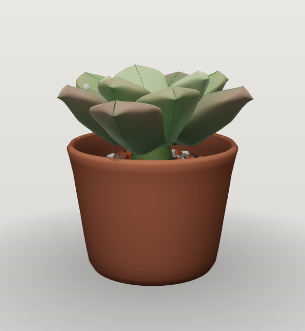

# 一小株多肉

[English](./README.md) · **简体中文**

[](https://github.com/taozhihaoo/a-little-succulent/actions/workflows/ci.yml)

一株住在桌面上的 3D 多肉。

它不是一段循环播放的动画，而是一株真的在被模拟的小植物：叶芽出生、展开、晒出红边、缺水时发皱，最终老去脱落；茎干缓慢长高并木质化成为老桩；基部长出侧芽，偶尔还会抽出花剑。关掉程序三天再打开，它正好长了三天——同样的叶子、同样的伤痕、同样的履历。

<p align="center">
  
</p>

Windows 桌面挂件 · Electron + three.js · 透明无边框、置顶、植物以外的区域鼠标穿透。

---

## 功能

- **真的在长** — 定步长模拟驱动叶片「出生 → 展开 → 成熟 → 衰老 → 脱落」全生命周期；另有光照不足导致的徒长、干旱应激、叶插繁殖。
- **确定性** — `种子 + 输入序列 + 模拟版本` 能逐字节复现同一株植物；快进调试也不会让它"跑偏"。
- **遗传** — 每株都有基因组（叶形、密度、色板、粉霜、光泽…），100 个种子长出 100 株一眼可分辨的莲座；稀有突变会带来锦化和缀化。
- **照顾循环** — 右键浇水。水分影响叶片饱满度、土色、光泽与生长速度；长期不管它，生长会停滞，叶尖泛出应激色。
- **长期事件** — 花剑抽芽、花苞次第开放与凋谢、侧芽、落叶生根成新株、老桩木质化，以及把这一切记下来的 Journal 时间线。
- **桌面原生** — 透明无边框、置顶、拖动、空白处穿透、托盘菜单、开机自启、大小/透明度设置、静默自动更新。
- **种子码** — 把一株植物导出成带校验的 Base32 短码发给别人，对方能种出同一株。
- **拍照** — `Shift+P` 把这一刻存成透明 PNG，文件名带上苗龄天数。

## 操作

| 操作 | 方式 |
| --- | --- |
| 浇水 | 右键点植株 → **浇水** |
| 移动挂件 | 拖动植株 / 花盆 |
| Journal（时间线与成就） | `J` |
| 设置（大小、透明度、自启、穿透、重置存档） | `S`，或托盘 → 设置 |
| 拍照（透明 PNG → 下载目录） | `Shift+P` |
| 隐藏 / 退出 | 托盘菜单 |

## 快速开始

环境：**Node.js ≥ 22**、**pnpm 12**（CI 里 `pnpm/action-setup` 固定为 12.8.1）。

```bash
pnpm install
pnpm dev          # Vite dev server + Electron，渲染层热更新
pnpm build        # 渲染层（vite）+ 主进程/preload（esbuild）→ apps/desktop/out
pnpm typecheck    # sim / render / desktop(web+node) 四份 tsc
pnpm lint
pnpm test         # vitest：模拟确定性、几何、持久化、调度器
```

打包（Windows，electron-builder → NSIS 安装包）：

```bash
pnpm --filter @succulent/desktop dist        # 安装包 → apps/desktop/dist-pkg
pnpm --filter @succulent/desktop dist:dir    # 免安装目录（A/B 双份输出）
```

## 它是怎么工作的

```text
packages/sim     纯 TypeScript 模拟层。不 import three.js / DOM / Node，也读不到当前时间。
                 世界状态 → PhenotypeSnapshot（姿态、颜色、水分、昼夜相位）
packages/render  three.js。只读快照，永不反推植物状态；独占渲染调度与全部几何。
apps/desktop     Electron 外壳：窗口、托盘、全屏检测、持久化、自动更新、Steam 成就。
                 renderer = 组合根 + UI。
```

三层之间只靠一个不可变快照对象通信：

- **确定性** — 固定步长（5 分钟网格）推进，随机数一律由 `seed|simTime` 派生，事件日志重放必得同一状态。
- **墙钟追赶** — 启动时把模拟推进到 `Date.now()`，所以关掉程序的这段时间也真实流逝；单调时钟防系统回拨。
- **存档是状态，不是几何** — `save.json` 检查点 + 只追加的 `events.jsonl` 事件日志 + `inputs.jsonl` 预写日志。几何永远在渲染时重新推导，因此渲染层可以随便重写而不破坏旧存档。
- **渲染成本** — 闲置时一帧都不画。Ambient 模式每几秒来一段 0.5~2 秒的短动画；只有指针停在植株上、或正在拖动时才连续渲染（前台全屏应用则强制进入 DeepIdle）。

细节见 [`ARCHITECTURE.md`](./ARCHITECTURE.md) 与 [`docs/`](./docs)。

## 开发调试工具

只在 `pnpm dev`（DEV 构建）里存在，打包产物中会被剔除：

| 按键 / 环境变量 | 作用 |
| --- | --- |
| `]` | 快进 7 个模拟日 |
| `Shift+G` | 浇水 + 快进 7 天（快速养出一株被照顾过的成熟株） |
| `K` / `L` | 昼相预览轮播 / 一日延时（60 秒一天） |
| `Shift+C`（再 `Shift+S`） | 100 株联系表（基因与视觉回归）+ 导出 PNG |
| `Shift+V` | 切换"绚丽向"基因组预设 |
| `I` | 模拟控制台（状态、事件、种子码、快进） |
| `SUCCULENT_SHOT=noon SUCCULENT_SHOT_SIZE=760x920` | 启动后按指定尺寸出图到临时目录并退出 |
| `SUCCULENT_TIMELAPSE=30` | 每个模拟日导出一帧（商店素材用） |
| `pnpm --filter @succulent/desktop soak 8` | 8 小时资源占用 soak 测试，输出 CSV |

## 数据与隐私

所有数据都只在本机：

```text
%APPDATA%\a-little-succulent\
  settings.json          窗口大小 / 透明度 / 自启
  window-bounds.json     上次位置
  succulent-save\
    save.json            检查点（只有状态）
    events.jsonl         事件日志（512 KB 轮转）
    inputs.jsonl         输入预写日志
```

- 没有统计、没有埋点、没有账号、没有广告。
- 唯一的网络请求是检查更新（electron-updater 访问 GitHub Releases），且只在打包版发生。
- 照片存到你的下载目录，开发截图存到系统临时目录；两者都不会上传。
- 删掉 `succulent-save\`（或设置面板里的重置）就是重新开始一株。存档没有云端副本——除非你在 Steam 上运行并启用了 Steam Cloud 镜像。

## 安全

渲染进程开启 `contextIsolation`、关闭 `nodeIntegration`，只能通过一层类型化的窄 IPC 桥与主进程通信；打包版通过自定义 `app://` 协议加载资源，任何越出打包目录的路径一律拒绝。

如果你发现安全问题，**请不要开公开 issue**，请通过 [GitHub Security Advisories](https://github.com/taozhihaoo/a-little-succulent/security/advisories/new) 私下报告，或在维护者 GitHub 主页所列邮箱联系。请附上复现步骤与版本号（托盘 → 设置里可见）。

## 许可

本仓库目前未授予任何开源许可证。源码公开用于阅读与贡献，著作权归作者所有；如需复用其中部分实现，请先联系作者。

---

<p align="center"><sub>用 three.js、一个定步长时钟，和很多耐心种出来的。</sub></p>
